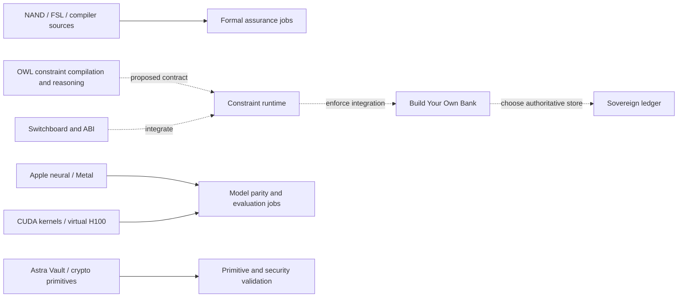

<!--
License-ID: SL-AGPL3-001 | Covenant-Version: 1.0 | Project policy reference
Main project policy: LICENSES/LicenseRef-Sovereign-Leviathan-SL-AGPL3-001.txt.
Existing file, component and third-party notices and grants are preserved.
-->

# Production staging and architecture

The current product catalog is the canonical component ownership registry. Keep source paths stable while converting each independently into a supported build. The old atlas is historical. The owner-requested component boundaries are explicit products rather than buried inside generic compiler, neural or symbolic categories.

| Family | Canonical products and paths | Production staging job |
|---|---|---|
| Banking | Build Your Own Bank; `finance/`, treasury Python modules; independent `sovereign/ledger/` | Installable CLI, replay/commit tests, provider sandbox integration |
| Apple neural networks and Metal | `apple-inference`; `metal/`, `apple-metal-inference/` | macOS build, tokenizer/weight parity, Metal kernel tests, decode/memory benchmarks |
| CUDA kernels | `cuda-kernels`; `src/cuda/`, `gpu/`, `languages/ptx/` | CUDA build, sanitizers, numerical parity and architecture-specific performance |
| Virtual H100 | `virtual-h100`; Dafny H100/CUDA models and VSM H100 bridge | Model/prover validation, explicit ISA/memory specification, separate silicon execution |
| NAND DSLs | `nand-dsl`; `he-binary-functor/nand-architecture/`, `gfnand/` | Parser/lowering, ISA fixtures, refinement proof jobs |
| FSL solver language | `fsl-kernel`; `rust/fsl/` | Rust library build and solver/IR tests; distinct from the similarly named license file |
| Switchboards | `virtual-switchboard`; Python, assembly and FFI | ABI build, deterministic routing, rollback and isolation fixtures |
| OWL and ahead-of-time constraints | `owl-aot-harness`; `astre-vault/astra_owl_solver.py`, `rcc8_spatial.py`; related `constraint-runtime` | Ontology conformance fixtures and explicit compiler/runtime artifact boundary |
| Astra Vault and crypto | `astra-vault`; math/Unlambda vault and `he-binary-functor/crypto/` | Primitive specification, deterministic vectors, security-property and cryptanalysis evidence |
| Hardware | `hardware-design`; `semiconductor/`, remaining `vsm2500/` | HDL simulation, synthesis/resource/timing reports; fabrication tracked separately |

Solid edges group validation work; dashed edges are integration requirements, not claims of completed interfaces. Neural suggestions do not gain treasury write authority merely by being connected to the architecture.

Staging levels: **source-mapped**, **build-verified**, **behavior-verified**, **integration-verified**, **pilot-ready**, **release-ready**. A release must record its source revision, component versions, build platforms, license notices, evidence artifacts and deployment configuration. No aggregate line count or header count promotes a component to release-ready.

The bank has a tested local CLI development foundation. Cross-process storage isolation, authentication/authorization, tenant separation, complete audit-state semantics and real rail integration remain pilot requirements. Apple/GPU, HDL and multi-prover jobs need their matching platforms; the low-memory workstation runs CPU checks only.

The OWL demo executes and reports an inconsistent sample ontology. Its current vault-close hook returns entropy and consistency metadata. The owner describes an ahead-of-time process and a novel cryptographic primitive; their exact compilation entry point and cryptographic specification must be linked before those capabilities receive production acceptance. Novelty is recorded as an owner contribution claim; cryptographic security is separately evaluated. The existing crypto seal-chain source uses FNV-1a-64 and is not promoted into the bank's security boundary by this staging change.
